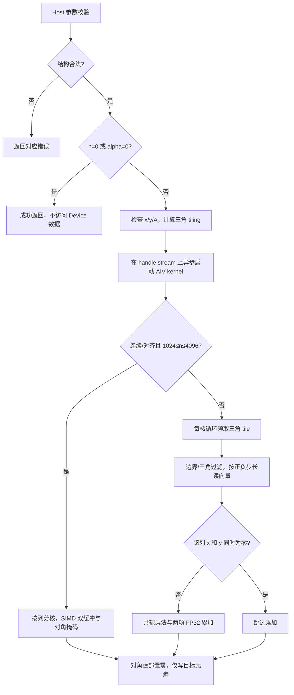

# aclblasCher2 算子设计文档（Ascend 950PR）

## 1 需求背景（required）

### 1.1 需求来源

CANN 社区任务：使用 Ascend C 在 Ascend 950PR、CANN 9.1.0 上实现 `aclblasCher2`。
实现接入 [ops-blas](https://gitcode.com/cann/ops-blas)，公共声明位于
`include/cann_ops_blas.h`，生产源码位于 `blas/syr2/arch35/`，测试位于
`test/syr2/cher2/arch35/`。

本文按 [社区设计模板](https://gitcode.com/cann/cann-competitions/blob/master/04_tasks/01_community-task-2026/resources/design_template.md)
编写。功能以任务书、[cuBLAS cublasCher2](https://docs.nvidia.com/cuda/cublas/index.html#cublas-t-her2)
及 [Netlib cher2.f](https://www.netlib.org/blas/cher2.f) 为依据。

### 1.2 背景与已有实现

目标为 BLAS Level-2 单精度复数 Hermitian 秩-2 更新。核对 ops-blas 基线
`05b96ea22cea926ecfd43fc7ac691a795522bd61`，当前没有 `aclblasCher2` 公共接口；
已有 `aclblasSsyr2`、`aclblasCsyr2` 可作为句柄、stream、构建与测试接入参考。
`aclblasCsyr2` 不执行复共轭；`aclblasCher2k` 属于 Level-3，均不能直接替代本接口。

| 核查项 | 结论 |
| --- | --- |
| 既有 TBE 实现 | 本任务新增句柄式 BLAS 接口，无对应 TBE 源码迁移 |
| ACLNN 算子信息库 | 不涉及；不创建 ACLNN 原型、注册或私有平行 API |
| 工程参考 | `blas/syr2/arch35/` 与 `test/syr2/` |
| 精度标杆 | Netlib BLAS 3.10.0 `cblas_cher2`，CblasColMajor |
| 性能标杆 | 随任务提供的 H100/cuBLAS `gpu_baseline.csv` |

## 2 需求分析（required）

### 2.1 功能与接口

计算公式：

```text
A := alpha * x * y^H + conj(alpha) * y * x^H + A
```

```cpp
aclblasStatus_t aclblasCher2(
    aclblasHandle_t handle, aclblasFillMode_t uplo, const int n,
    const aclblasComplex* alpha,
    const aclblasComplex* x, const int incx,
    const aclblasComplex* y, const int incy,
    aclblasComplex* A, const int lda);
```

| 参数 | 位置/类型 | 语义与约束 |
| --- | --- | --- |
| handle | Host，aclblasHandle_t | 有效句柄，通过 aclblasSetStream 绑定 stream |
| uplo | Host，aclblasFillMode_t | ACLBLAS_UPPER 或 ACLBLAS_LOWER |
| n | Host，int | n≥0；A 的逻辑阶数 |
| alpha | Host，const aclblasComplex* | complex64 标量；指针不能为空，直接在 Host 读取 |
| x/y | Device，const aclblasComplex* | 只读，逻辑长度 n，物理长度至少 1+(n−1)×abs(inc) |
| incx/incy | Host，int | 正负非零步长，以复数元素计 |
| A | Device，aclblasComplex* | 原地输入/输出，物理形状 lda×n，列主序 |
| lda | Host，int | lda≥max(1,n) |

alpha、x、y、A 均为复数单精度，实部/虚部各 float32。没有 beta、广播或额外 Tensor
stride；n 是运行时参数。仅引用/更新 uplo 指定三角，另一个三角和 padding 不读不写。
对角虚部不参与计算；非 no-op 更新后强制写 0。

### 2.2 参数校验与 quick return

按以下顺序执行，所有校验在 kernel 下发前完成：

1. handle 为空：`ACLBLAS_STATUS_HANDLE_IS_NULLPTR`。
2. n<0：`ACLBLAS_STATUS_INVALID_VALUE`。
3. uplo 非法：`ACLBLAS_STATUS_INVALID_ENUM`。
4. lda<max(1,n)、incx/incy 为 0、alpha 为空：`ACLBLAS_STATUS_INVALID_VALUE`。
5. 结构合法且 n=0：返回 SUCCESS，不读取 alpha 的值，也不访问 x/y/A。
6. 读取 Host alpha；alpha=(0,0)，包括正负零：返回 SUCCESS，不访问 x/y/A。
7. 其余情况 x/y/A 为空：`ACLBLAS_STATUS_INVALID_VALUE`。
8. 获取平台 AIV 核数，计算 tiling，在 handle 的 stream 上异步启动 kernel。

n=0 不绕过结构校验。alpha=0 时整个 A（包括旧对角虚部）保持原样。
任务书仅承诺 Host alpha，本方案不扩展 Device alpha，也不引入同步 D2H 标量读取。
异步设备错误由调用方的 stream 同步发现。

**任务资料差异说明**：任务书要求任意非零步长，但附带 CSV 的 `TC_ED_219/220`
明确要求 INT_MIN 返回 INVALID_VALUE。首版按附带测试的增强约束拒绝 INT_MIN，
其余步长先提升至 int64 再计算绝对值和起点。该例外在接口文档、自测报告中明确列出，
请评审确认最终统一口径；不得依靠有符号溢出来拒绝该值。

### 2.3 验收要求

| 项目 | 要求 |
| --- | --- |
| 硬件/软件 | Ascend 950PR，CANN 9.1.0，Ascend C kernel 直调 |
| 精度 | 实部/虚部分别比较；atol=rtol=2^-13，matched_ratio≥0.99，绝对误差满足 1e-2 或 32 ULP 上限 |
| 特殊值 | 两侧 NaN、同号 Inf、NaN/Inf 组合等效；有限值/非有限值组合不通过 |
| 写保护 | 未引用三角、padding、缓冲区 guard 逐字节不变；x/y 只读 |
| 性能 | 每个 case 的 NPU Avg(us)≤GPU Avg(us)/0.4 |
| 工程 | 公共 API、README、CSV/GTest、复现步骤、设计文档、自测报告及原始日志 |

## 3 详细设计（required）

### 3.1 数学展开与数值顺序

按 Netlib 每列 j 计算：

```text
temp1 = alpha * conj(y[j])
temp2 = conj(alpha * x[j])
A[i,j] = (A[i,j] + x[i] * temp1) + y[i] * temp2       # i != j
A[j,j].real = A[j,j].real + real(x[j]*temp1 + y[j]*temp2)
A[j,j].imag = 0
```

复数乘法 `(a+ib)(c+id)` 展开为 `(a*c-b*d)+i(a*d+b*c)`。每个乘积独立舍入至
FP32，再进行加减；避免编译器将两项融合后改变有限大数溢出的 Inf/NaN 行为。
对角先合并两项更新再加旧实部，非对角按上述顺序累加。

当 x[j]、y[j] 同时恰为 (0,0) 时，Netlib 跳过整列乘加，只将对角虚部清零。
该分支必须保留，否则其他行含 Inf/NaN 或 alpha 非有限时，0×Inf 会把应保持有限的
元素变为 NaN。测试需覆盖“零列与非有限值混合”，不能仅分别测全零和全 Inf。

### 3.2 Host 侧设计

复用 `aclblasHandle_t` 内部 stream 与平台查询函数 `GetAivCoreCount()`。
Host 传递的 tiling 字段为 n、lda、上/下三角标记、alpha 实部/虚部、int64 incx/incy。
无 Device 临时工作区，无每次调用的内存申请和 stream 同步。

设分块边长 B=64，S=ceil(n/B)，目标三角共有 T=S(S+1)/2 个 tile。
启动 block 数为 min(T, 平台 AIV 核数)，不硬编码 56 核。
每个 block 按 `blockIdx + k*gridDim` 遍历三角 tile，任意 block 数均覆盖全部工作。

### 3.3 Kernel 侧设计

实现包含 AIV SIMD 双缓冲路径与 SIMT 通用路径，均在一个 kernel 内完成。
当 1024≤n≤4096、incx=incy=1 且 x/y/A 满足 8 字节对齐时采用 SIMD 路径：

- 每核处理 `col=blockIdx+k*gridDim`，GM 偏移使用 uint64，DMA 只搬运该列的目标三角区间。
- x/y 分离为实虚四个 UB 平面，按 Netlib 顺序预计算 `alpha*conj(y)` 与 `conj(alpha*x)`。
- 两个 A 列缓冲轮换，提前加载下一列，当前列完成向量计算后异步写回；复用缓冲前等待写回完成。
- 共使用 `12*(4096+64)*4=199680` 字节 UB，低于本设备 253952 字节容量；无需 GM workspace。
- 零列保留 A 实部及非对角数据，通过带掩码的向量存储清零对角虚部，避免跨流水标量写入遗漏。
- 对角实部使用 `oldReal+(r1+r2)`，非对角使用 `(oldReal+r1)+r2`；对角虚部最终选择常数 0。

其他输入使用 Ascend C 的 AIV/SIMT 接口，每个 64×64 tile 由 1024 个线程处理：64 个行 lane、
16 个列 lane，每个列 lane 按 16 列步长处理最多 4 个元素。warp 内相邻行 lane 对应
列主序连续元素，合并 GM 访存。向量的行元素在寄存器中复用，避免临时矩阵和额外 kernel。

三角 tile 编号 t 的映射：

```text
major = floor((sqrt(8*t+1)-1)/2)
minor = t - major*(major+1)/2
UPPER: tileRow=minor, tileCol=major
LOWER: tileRow=major, tileCol=minor
```

以整数比较校正 sqrt 的舍入误差，保证映射无重复、无遗漏。分块和地址的乘积采用
宽整数。边界 tile 先判断 row/col<n；对角 tile 再判断 row≤col 或 row≥col，只有
满足条件后才访问 A。每个元素由唯一线程负责，既无原子操作也无跨核同步。

向量逻辑索引为：

```text
index(i,inc) = i*inc                  if inc > 0
             (n-1-i)*(-int64(inc))   if inc < 0
```

矩阵复数偏移为 `uint64(col)*lda+row`，两 float 的偏移再乘 2。
当 incx=incy=1 且 `uint64(n)*lda <= 0x7fffffff` 时，所有 float 偏移可证明落在 uint32
范围内，采用 32 位索引。该路径中 x/y/A 地址均满足 8 字节对齐时，非对角复数使用
float2 读写；4 字节对齐地址保持标量读写。其他步长和大地址使用 64 位通用路径。
非对角 tile 在编译期去除三角掩码和对角特殊处理，对角 tile 保留完整语义。
基本路径使用 float 访存，支持公共 complex ABI 的 4 字节对齐；所有成对访存均有 8 字节对齐保护。



### 3.4 性能分析与优化

主要流量是目标三角 A 的读取与写回，约 `16*n*(n+1)/2` 字节，向量较小且会复用。
根据实测完成以下优化：

- 小矩阵减少无效线程和核启动成本。
- 连续步长且索引范围可证明安全时选择 uint32 索引，降低 SIMT 宽整数开销；超界保留宽索引。
- 对齐地址采用 float2 访存；未对齐、负步长仍保留完整语义。
- 中大连续矩阵采用原生向量计算和 DMA 双缓冲，减少重复乘法及搬运等待。
- 根据实际访存与占用率调整 tile/线程数，每次改变调度后回归全部边界和特殊值。
- 不通过改变累加次序、忽略零列分支或放宽精度阈值换取性能。

完整验证数据以最终自测报告和原始采样为准，不以单个用例结果代替全量判定。

### 3.5 工程文件

```text
include/cann_ops_blas.h
blas/syr2/arch35/cher2_host.cpp
blas/syr2/arch35/cher2_kernel.cpp
blas/syr2/arch35/cher2_kernel.h        # tiling ABI 与 launch 声明
blas/syr2/arch35/cher2_aiv_kernel.h    # SIMD 双缓冲实现
blas/syr2/README.md

test/syr2/cher2/CMakeLists.txt
test/syr2/cher2/cher2_param.h
test/syr2/cher2/cher2_golden.h
test/syr2/cher2/README.md
test/syr2/cher2/arch35/cher2_test.cpp
test/syr2/cher2/arch35/cher2_npu_wrapper.h
test/syr2/cher2/arch35/cher2_test.csv
```

生产源码由现有构建自动发现，不添加私有 CMake 框架。测试通过
`ops_blas_add_gtest_tests` 注册，CPU golden 使用系统 Netlib CBLAS；不把 CPU golden
或测试特化逻辑放入生产 kernel。

## 4 可维可测分析

### 4.1 功能和精度测试

执行原始 CSV 全部 1200 个 case：1000 个精度 case 与 200 个性能 case。
日常精度回归显式排除 TC_PF；性能场景独立采集。发布前可对全部性能形状额外做一次
单次更新的 golden 校验，不将该时长作为 kernel 耗时。

补充测试：

- 空 handle，n=0/alpha=0 与非法结构参数组合，空 alpha/x/y/A。
- 全部 ±1/±2/±3 的 x/y 步长组合，uplo 两侧，n=1、非对齐 n、lda padding。
- n=65/513 时 x/y 的全部 ±1000 组合；n=1 时 INT_MAX、INT_MIN+1 的全部组合。
- 均匀和正态各 50% 的独立随机测试组，alpha 实虚部独立取样。
- 对角旧虚部为非零/NaN；no-op 必须保留旧值，普通更新必须置零。
- Inf/NaN/大数溢出、x/y 零列混合、复数 alpha 的纯虚/非有限输入。
- 4 字节偏移、前后 guard、未引用三角及 padding 的 NaN payload 哨兵。

实部和虚部分别记录 finite_count、matched_count、max_abs_error、nonfinite_count、
nonfinite_matched；非有限元素不进入有限误差统计。CSV 的 MERE/MARE 阈值作为独立
补充校验，不替换任务书的固定混合容差。

哨兵只能证明没有改写；“不读取未引用三角”还须结合 kernel 访问条件审查与
`mssanitizer --tool=memcheck` 检查，不能仅凭哨兵不变就宣称未读。

### 4.2 性能与内存验证

正式性能以 `msprof op` 的 `Task Duration(us)` 采样，剔除 warmup 后逐 case 对比
H100 基线，保证参数（uplo/n/alpha/incx/incy/lda）逐项一致。任务书 §3.3 要求每例
10 个有效样本，全部 200 个用例分别满足 GPU/NPU ≥ 0.4。任务资料末尾和测试 README
又要求 >10/>50；采集脚本支持 51 个有效样本，同时报告前 10 个和全部样本均值。
普通 msprof 的额外稳定性结果单独记录，不作为 op 模式结果。所有样本须对应接口返回 SUCCESS。

性能采集路径只准备一次 Device 数据，独立于 CPU golden；原地更新在 warmup/replay
中会重复执行，不能把其结果误当一次更新与 golden 比较。GTest 整条用例的毫秒时长、
Host wall time 和 ACL event 时间不替代 `msprof op` Task Duration。

无 Device workspace。测试控制 Host 内存峰值在 512 MB 内，保存最大形状、内存
检查日志、接口状态和精度/性能的原始 CSV/XML；无错误的 memcheck 才能报告内存检查通过。

### 4.3 环境风险与验收边界

容器中设备的物理编号与逻辑编号可能不同；采集前应确认 profiler 的设备映射。
如需重建工具注入组件，应使用固定版本的未修改上游源码并安装到独立目录。
完整工具版本、原始采样及工具警告随交付包中的自测报告保存；
复现方式见[测试 README](../../../test/syr2/cher2/README.md)，
评审记录见[PR #713 讨论](https://gitcode.com/cann/ops-blas/pull/713/discuss)。系统工具未修改。

开发者自验证与社区设计评审、任务系统官方验收分别记录，不能相互替代。
性能未达标、缺失采样、零用例、测试进程异常均不可标记通过。

### 4.4 支持硬件与约束

| 支持的芯片版本 | 支持状态 |
| --- | --- |
| Ascend 950PR（arch35） | 已实现并完成真机自测 |

仅支持 complex64、列主序和 Host alpha；不涉及广播。n、lda、步长、对齐和
INT_MIN 例外见 2.1、2.2 与 3.3 节。A 的非目标三角和 padding 保持不变。

## 5 兼容性与参考资料

新增公共 API，不改变既有接口。当前实现仅面向 arch35/950PR，其他产品线复用同一
声明扩展实现，不建立 950PR 专用平行函数。生产不依赖 Netlib/CUDA，二者仅用于测试或标杆。

- [Netlib CHER2](https://www.netlib.org/blas/cher2.f)
- [cuBLAS CHER2](https://docs.nvidia.com/cuda/cublas/index.html#cublas-t-her2)
- [混合容差标准](https://gitcode.com/cann/opbase/blob/28a1ce52ae856353589841226a0002af73314a6b/docs/zh/ops_precision_standard/mixed_tolerance_standard.md)
- [社区流程](https://gitcode.com/org/cann/discussions/39)
- [ops-blas 贡献指南](https://gitcode.com/cann/ops-blas/blob/master/CONTRIBUTING.md)

文档使用 OpenAI Codex 辅助核查参考源码、起草设计及测试方案；测试结果以真机日志为准。
